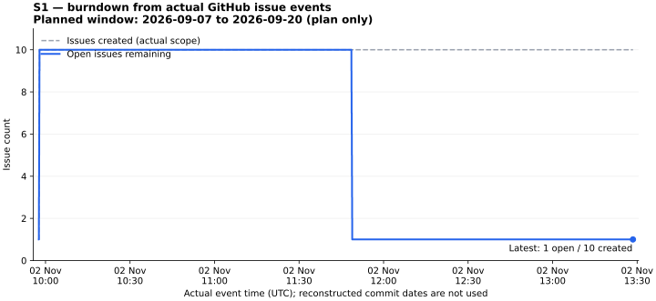
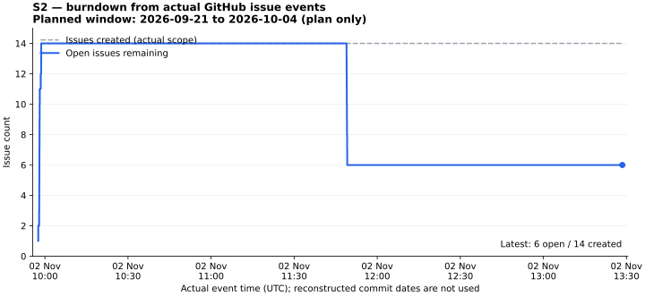

# TixFlow V2

Personal event-ticketing project imported from [nvtank/ticketflow-aws](https://github.com/nvtank/ticketflow-aws) at `91833bcc0048b596c2dbf7e9dc25358c77541daf` by explicit user request. Actual importer: authenticated `nvtank`.

**Reconstructed timeline:** import commits allocate author/date metadata by the requested roles and W1–W9 windows. They are labelled SIMULATED and do not prove historical contributions by those accounts. Original `main` history remains an ancestor, so this branch supports an ordinary pull request. The earlier orphan simulation branch is retained as a separate experiment.

Roles for allocation: `nvtank` PM/CloudOps; `TuanAn0311` architecture/backend; `nguyen-van-hoan` frontend/API integration/browser E2E. The full code already existed in the source repository; commit grouping is an import organization scheme.

## Run locally

Use Node 24 and pnpm 10.34.1. Run `pnpm install --frozen-lockfile`, `pnpm env:setup`, `pnpm infra:up`, `pnpm db:generate`, `pnpm db:migrate`, `pnpm db:seed`, then `pnpm dev`.

On NixOS with nix-ld enabled, run `node scripts/setup-prisma-nixos.mjs` after installing dependencies and before Prisma commands. Repeat after upgrading Prisma. This selects the matching runnable schema engine through the ignored `apps/api/.env`.

Stop `pnpm dev` before running `pnpm build` or `pnpm db:seed`: the API build replaces `dist`, which the dev watcher also uses. After building/seeding, restart `pnpm dev`. The seed adds 8 demo events and 10 fictional artists, preserving existing demo passwords and sold inventory. Sign in as `admin@tixflow.local` with `DEMO_PASSWORD` from your root `.env`, then open `/admin` (an existing account keeps its current password).

Web: http://127.0.0.1:3100. API: http://127.0.0.1:4100/api/v1. Development PostgreSQL/Redis: loopback 55444/56394. The `.env` helper generates random secrets without printing them. Payments remain disabled unless configured; mock is restricted to development/test. No paid AWS resource, production change or real payment has been executed.

The imported database schema/migrations replace the earlier V2 prototype. Use the new isolated database/Compose project; do not apply this migration history to the earlier prototype database.

## Validate the import

`pnpm lint`, `pnpm typecheck`, `pnpm format:check`, `pnpm test`, `pnpm build`.

Real PostgreSQL/Redis integration: `pnpm test:infra:up`, `pnpm test:db:prepare`, `pnpm test:integration`. Test services use the distinct Compose project `ticketflowv2-import-test`, loopback ports 55443/56393 and ephemeral PostgreSQL storage. Browser suites: `pnpm test:e2e` and `pnpm test:e2e:integration`; each suite/viewport starts a fresh API process.

NixOS needs a compatible Prisma schema engine and browser/runtime libraries. See actual import test results under `docs/reference/import-validation/` once recorded. Source file hashes and port adaptations are in [SOURCE_IMPORT_MANIFEST.json](docs/reference/SOURCE_IMPORT_MANIFEST.json).

The [imported README](docs/reference/IMPORTED_SOURCE_README.md) and source `docs/` contain historical reference material. Earlier `docs/qlda` artifacts remain preserved from the original request; they do not imply stakeholder acceptance or historical execution for this personal import. Existing source reports are not new test results.

## Live GitHub Project and actual burndown

[Delivery board](https://github.com/users/nvtank/projects/2/views/2) · [Sprint 1](https://github.com/users/nvtank/projects/2/views/4) · [Sprint 2](https://github.com/users/nvtank/projects/2/views/5).

The Project has Backlog, In Progress, In Review and Done columns, all 45 backlog Issues, owner/estimate/evidence fields and baseline Sprint iterations. Actual completion dates come from GitHub Issue closure events; the reconstructed import commit dates are not used for metrics.

See [actual event history and CSV exports](docs/project/README.md). The baseline Sprint 1/Sprint 2 windows are plans; chart data begins with the actual GitHub observations on 2026-11-02. Current exported snapshot: 25 technical Issues completed; Sprint 1 has 9/10 completed and Sprint 2 has 8/9 completed. Remaining mixed retrospective/staging acceptance is not claimed complete.
