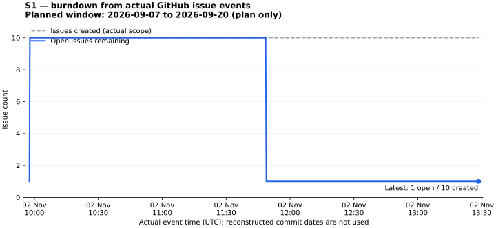
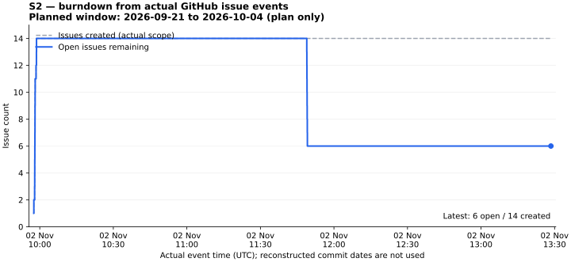

# TixFlow V2

An event-ticketing platform covering the full operational workflow: organizer onboarding and approval, event publishing, seat-level booking with atomic holds, payment settlement, signed QR tickets, staff check-in, and analytics.

TypeScript monorepo — Next.js 16 frontend, NestJS 11 API, PostgreSQL via Prisma 7, Redis, Socket.IO realtime.

> **Provenance.** This repository was imported from [nvtank/ticketflow-aws](https://github.com/nvtank/ticketflow-aws) at `91833bcc0048b596c2dbf7e9dc25358c77541daf` by the authenticated user `nvtank`. Import commits allocate author and date metadata across W1–W9 windows by assigned role; those commits are labelled **SIMULATED** and are not evidence of historical contribution by the named accounts. The full codebase already existed in the source repository — commit grouping is an organizational scheme, not a development record. Role allocation: `nvtank` (PM/CloudOps), `TuanAn0311` (architecture/backend), `nguyen-van-hoan` (frontend/API integration/browser E2E).

## Architecture

| Workspace         | Stack                                                 | Responsibility                                                |
| :---------------- | :---------------------------------------------------- | :------------------------------------------------------------ |
| `apps/web`        | Next.js 16 (App Router), React 19, Tailwind 4         | Public catalog, booking UI, organizer and admin workspaces    |
| `apps/api`        | NestJS 11, Prisma 7 (`@prisma/adapter-pg`), Socket.IO | Domain API, seat-hold lifecycle, settlement, realtime gateway |
| `packages/shared` | TypeScript                                            | Contracts and validation shared by both apps                  |
| `packages/config` | TypeScript, ESLint                                    | Base compiler and lint configuration                          |

The API is organized by domain: `auth`, `users`, `organizations`, `events`, `booking`, `orders`, `payments`, `tickets`, `check-in`, `waiting-room`, `notifications`, `analytics`, `admin`, `discovery`, `realtime`, `monitoring`, `health`.

**The browser never addresses the API directly for REST.** It calls the same-origin path `/api/v1/*`, which `apps/web/next.config.ts` rewrites server-side to `API_INTERNAL_URL`. Socket.IO is the exception: it connects to the API directly, so that origin must appear in the API's `CORS_ORIGINS` or realtime features fail while REST still appears healthy.

**Hosting is split** ([CR-20261112-003](docs/qlda/changes/CR-20261112-003-vercel-hosting-split.md)): `apps/web` deploys to Vercel; `apps/api` stays on Docker/AWS because it requires a persistent process — in-process seat-hold expiry intervals, a Socket.IO server, and a managed PostgreSQL connection pool do not survive an ephemeral serverless model. The database may be a local container or a Supabase-hosted PostgreSQL instance ([CR-20261114-004](docs/qlda/changes/CR-20261114-004-supabase-postgres.md)); only `DATABASE_URL` changes between them.

## Quick start

Requires Node 24, pnpm 10.34.1, Docker Engine with Compose, Python 3, and Git.

```sh
pnpm install --frozen-lockfile
pnpm env:setup          # generates random secrets into .env without printing them
pnpm infra:up           # PostgreSQL and Redis on loopback
pnpm db:generate
pnpm db:migrate
pnpm db:seed
pnpm dev
```

| Service            | Address                      |
| :----------------- | :--------------------------- |
| Web                | http://127.0.0.1:3100        |
| API                | http://127.0.0.1:4100/api/v1 |
| PostgreSQL / Redis | loopback 55444 / 56394       |

The seed creates 8 demo events and 10 fictional artist profiles, and preserves existing demo passwords and sold inventory on re-runs. Sign in as `admin@tixflow.local` with the `DEMO_PASSWORD` from your root `.env`, then open `/admin`. An account that already exists keeps its current password.

**Stop `pnpm dev` before running `pnpm build` or `pnpm db:seed`.** The API build replaces `dist/`, which the dev watcher is reading; running both concurrently crashes the watcher. Restart `pnpm dev` afterwards.

Payments are disabled unless explicitly configured, and the mock provider is restricted to development and test. No paid AWS resource, production change, or real payment has been executed from this repository.

### NixOS

Prisma publishes no engine build for the `linux-nixos` target, so every Prisma CLI command fails with a 404 until a runnable engine is selected. With nix-ld enabled, run this once after installing dependencies and again after any Prisma upgrade:

```sh
node scripts/setup-prisma-nixos.mjs
```

It downloads the official engine for the exact commit the installed CLI expects and records the path in the gitignored `apps/api/.env`. The script is idempotent and exits immediately on other distributions.

## Testing

```sh
pnpm lint && pnpm typecheck && pnpm format:check && pnpm test && pnpm build
```

Integration tests run against real PostgreSQL and Redis in a separate Compose project (`ticketflowv2-import-test`, loopback 55443/56393, ephemeral storage):

```sh
pnpm test:infra:up
pnpm test:db:prepare
pnpm test:integration
```

Browser coverage is split across focused Playwright suites, each starting a fresh API process: `pnpm test:e2e:auth`, `:events`, `:booking`, `:payments`, `:checkin`, `:waiting`, `:google`, `:experience`. Run the full set with `pnpm test:e2e:integration`.

The required `quality` workflow (`.github/workflows/ci.yml`) runs the same checks on every pull request. `cd.yml` exercises health-gated rollout and automatic rollback against real containers on each push to `main`; its remote deploy job stays skipped until AWS credentials are configured, rather than silently passing.

## Deployment

| Component  | Target                 | Notes                                                                              |
| :--------- | :--------------------- | :--------------------------------------------------------------------------------- |
| `apps/web` | Vercel                 | Root directory `apps/web`; needs `API_INTERNAL_URL` and `NEXT_PUBLIC_REALTIME_URL` |
| `apps/api` | Docker (staging) / AWS | Persistent process; see [staging runbook](docs/operations/STAGING.md)              |
| PostgreSQL | Container or Supabase  | Connection string only; schema and migrations are identical                        |
| Redis      | Container              | Seat-hold leases, waiting-room queue, optional Socket.IO adapter                   |

The frontend never holds database credentials — it has no database access of any kind. When the frontend is hosted separately from the API, set `PUBLIC_WEB_ORIGIN` in the staging environment so its origin reaches `CORS_ORIGINS`; `STAGING_ORIGIN` is reserved for the stack's own browser origin and is rewritten automatically by the tunnel script.

The AWS Terraform under `infrastructure/aws/` provisions ECR, VPC, OIDC, SSM, KMS, and ACM only. It contains **no compute, database, or load-balancer resources**, has never been applied, and is statically validated only. See the [AWS runbook](docs/operations/AWS_RUNBOOK.md) for the gated procedure.

## Documentation

| Area                   | Location                                                                           |
| :--------------------- | :--------------------------------------------------------------------------------- |
| Operations runbooks    | [`docs/operations/`](docs/operations/) — staging, CD, AWS, backup/restore, tunnel  |
| Project management     | [`docs/qlda/`](docs/qlda/) — WBS, scope baseline, change records, sprint artifacts |
| Architecture decisions | [`docs/adr/`](docs/adr/)                                                           |
| Requirements           | [`docs/requirements/`](docs/requirements/)                                         |
| Import reference       | [`docs/reference/`](docs/reference/) — source manifest, imported README            |
| Evidence               | [`docs/operations/evidence/`](docs/operations/evidence/)                           |

Evidence notes record what was actually executed, including failures and unverified steps. Preserved `docs/qlda` artifacts do not imply stakeholder acceptance; reports inherited from the source repository are not new test results.

## Delivery tracking

[Delivery board](https://github.com/users/nvtank/projects/2/views/2) · [Sprint 1](https://github.com/users/nvtank/projects/2/views/4) · [Sprint 2](https://github.com/users/nvtank/projects/2/views/5)




Completion dates come from GitHub Issue closure events, never from the reconstructed import commit dates. The baseline sprint windows are plans; chart data begins at the first actual GitHub observation on 2026-11-02. Current counts and the full event history live in [`docs/project/`](docs/project/README.md) and are regenerated from the API rather than maintained by hand.

## Contributing

See [CONTRIBUTING.md](CONTRIBUTING.md). Work is submitted by pull request; `main` requires one approving review and a passing `quality` run. Never apply this migration history to the earlier V2 prototype database — the imported schema replaces it and expects an isolated database and Compose project.
