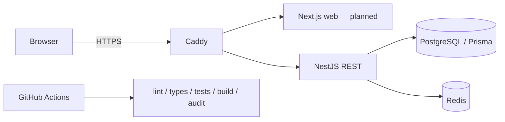
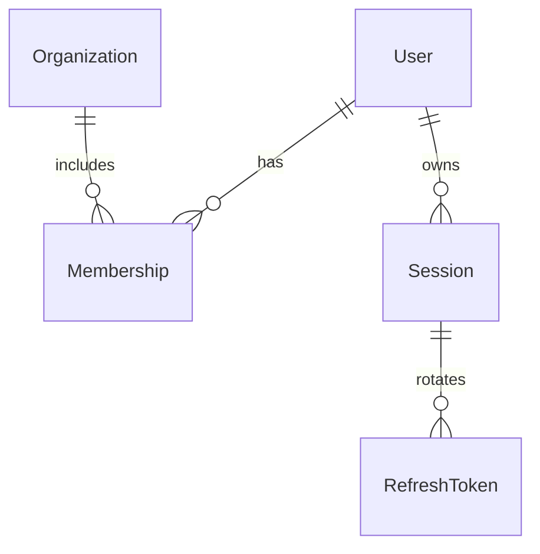

# Architecture ADR-001 — proposed, awaiting Tech Lead review

Use a modular monolith: NestJS REST owns authentication, event policy and PostgreSQL transactions; Next.js consumes shared validated contracts. PostgreSQL is authoritative for sessions, tenant membership and booking/settlement. Redis supports readiness now and optional realtime/cache later. Its availability never substitutes for a database lock.

Initial implementation: environment validation, security headers, explicit CORS origin, liveness/readiness, identity/organization/session schema. No application code from the reference repository is reused. API namespace `/api/v1`; liveness `/health/live`, readiness `/health/ready` checks DB and Redis. Dependency failure returns 503 without connection strings. Startup fails if the database is unreachable.

Auth design: password scrypt, 15m JWT with issuer/audience/session ID; random refresh cookie, hash stored in DB; stable session lock serializes rotation and replay revokes session in a committed transaction. Role is read from the current DB user. Organization membership is required independently of role. Registration never grants elevated roles. Cookie refresh/logout require exact allowed Origin; production uses Secure/HttpOnly/SameSite cookies. No access token or password is logged.

Planned event/booking extension: Organization → Event → Zone/Seat; User → Hold → Order; Order → Payment/Ticket → CheckIn. Draft → pending review → approved/published transitions are server enforced. Seats are row locked in canonical order; TTL uses database time; order amount comes from immutable server price snapshots. Provider signature/amount/order/currency/reference must match before once-only ticket issue. Check-in uses an atomic conditional VALID→USED write after staff assignment validation. Unique constraints and idempotency keys support replay safety. These planned entities are not claimed implemented in the foundation schema.

REST draft: auth register/login/refresh/logout/me; organization-scoped event create/update/submit, ADMIN review, public approved-only catalog; hold/create/release, orders, verified payment webhook, owned tickets, assigned staff check-in and scoped analytics. Each request validates a shared schema, validates tenant/role and returns controlled 400/401/403/404/409 errors. Avoid returning foreign tenant existence.

NFR baseline: fail closed on unavailable auth/session storage; 100KB JSON limit; no secrets in errors; bounded input; isolated test database; responsive 320/390px and keyboard behavior tested when UI is implemented. No public capacity/HA claim. Single-node AWS demo and HTTPS/backup/rollback require approved deployment; no resources have been created.

References: [NestJS first steps](https://docs.nestjs.com/first-steps), [GitHub Projects API scope](https://docs.github.com/en/issues/planning-and-tracking-with-projects/automating-your-project/using-the-api-to-manage-projects), supplied Master Prompt and QLDA guidelines. Prisma is pinned to 7.10.1; do not apply incompatible latest-major examples without migration review.
