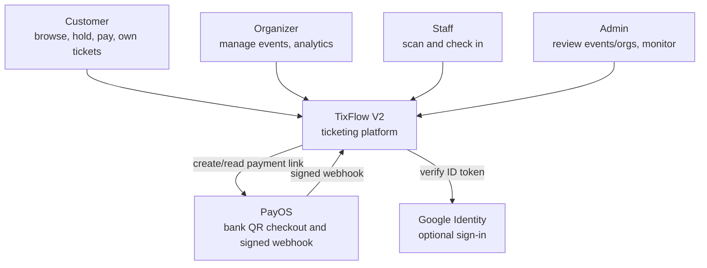
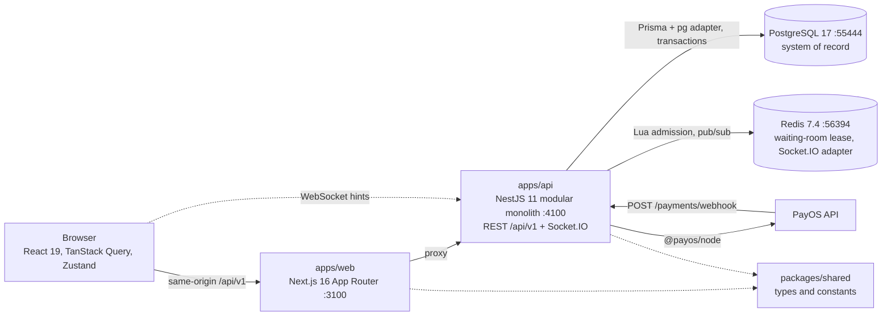
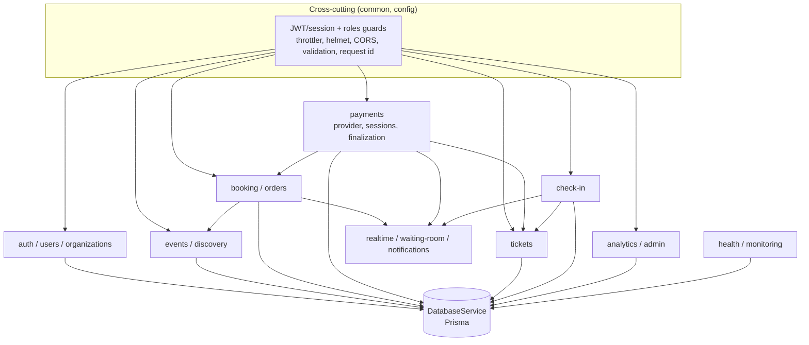
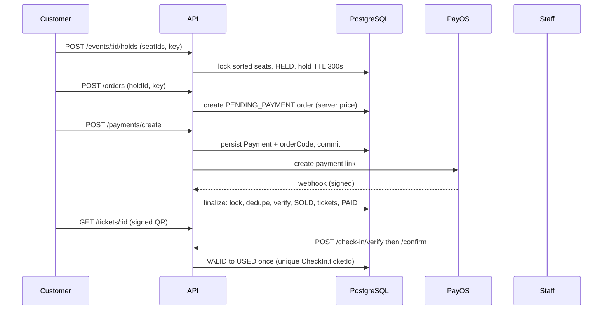

# C4 diagrams (TF2-007)

Reconciled with the imported code. Ports are the V2 local defaults from `.env.example` (web 3100, API 4100, PostgreSQL 55444, Redis 56394). No AWS resource is provisioned; AWS is a future deployment target only (TF2-038/040).

## Level 1 — System context

## Level 2 — Containers

## Level 3 — API components

Arrows mean "depends on / calls". Realtime publication happens only after commit (see [ADR-001](adr/001-modular-monolith.md)).

## Core flow

## Known doc drift

`docs/architecture.md` diagram shows legacy ports 3000/4000/5432/6379; the V2 defaults above come from `.env.example` and `infrastructure/`.
