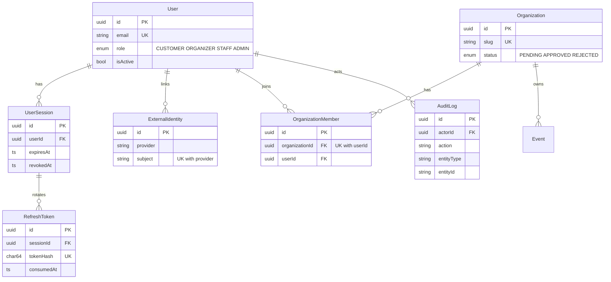
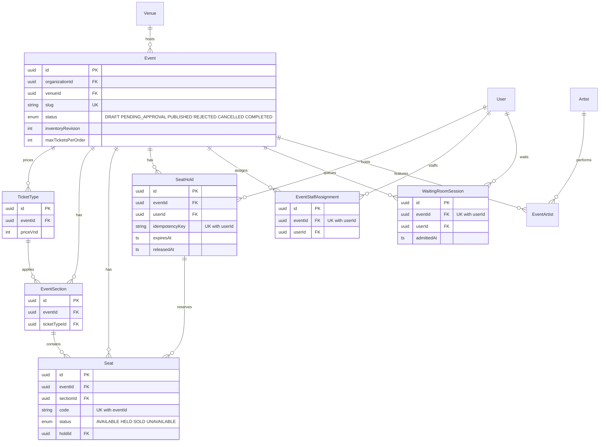
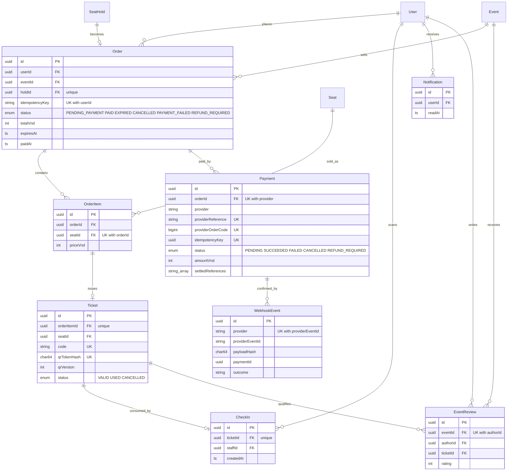

# Entity relationship diagram (TF2-007)

Source of truth: `apps/api/prisma/schema.prisma` (25 models, 10 migrations under `apps/api/prisma/migrations`). Only key columns are shown; see the schema for all fields, indexes and the SQL CHECK constraints added in migrations.

> `docs/database.md` historically says "21 models"; the schema currently contains **25**.

## Identity and tenancy

## Catalog, seats and holds

## Orders, settlement, tickets and check-in

`WebhookEvent.paymentId` is a plain column in the schema (no Prisma relation); the line above is a logical relationship.

## Design rules encoded in the schema

| Rule                                     | Mechanism                                                                         |
| ---------------------------------------- | --------------------------------------------------------------------------------- |
| Seat, section and event stay consistent  | composite FKs `(id, eventId)` on Seat, EventSection, SeatHold, Order, OrderItem   |
| One order per hold, retries idempotent   | `Order.holdId` unique; `(userId, idempotencyKey)` unique on SeatHold and Order    |
| One payment attempt per order/provider   | `Payment @@unique([orderId, provider])`, unique `providerOrderCode`/`idempotencyKey` |
| Duplicate webhook events are detected    | `WebhookEvent @@unique([provider, providerEventId])` plus `payloadHash`           |
| One ticket per order item                | `Ticket.orderItemId` unique                                                       |
| Check-in is once-only                    | `CheckIn.ticketId` unique, plus conditional `VALID → USED`                        |
| Tenant scoping                           | `OrganizationMember` unique `(organizationId, userId)`; service-level checks      |
| Money is integer VND, time is UTC        | `Int` columns, `Timestamptz(3)`                                                   |

Raw-SQL CHECK constraints and partial unique indexes live in the migration SQL (for example one active `VALID`/`USED` ticket per seat) and are described in `docs/database.md`.

