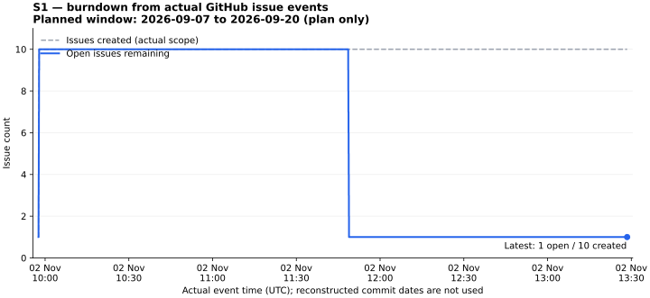
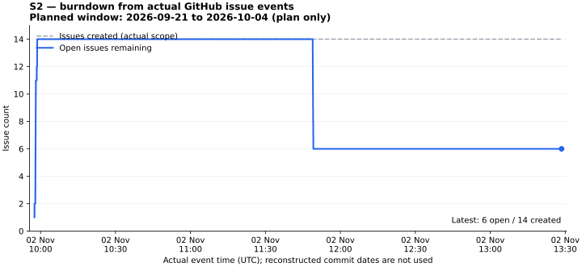

# GitHub Project and actual Sprint data

Project: https://github.com/users/nvtank/projects/2

- [Board](https://github.com/users/nvtank/projects/2/views/2): Backlog, In Progress, In Review, Done.
- [Sprint 1](https://github.com/users/nvtank/projects/2/views/4): saved filter `sprint:S1`.
- [Sprint 2](https://github.com/users/nvtank/projects/2/views/5): saved filter `sprint:S2`.
- Additional saved views: Table, Baseline Roadmap, By Owner, Blocked, Done. The initial GitHub default view is preserved.

All 45 Issues are real repository Issues. The fields include Sprint, baseline iteration, Priority, proposed Story Points, WBS, Module, DRI, planned Start/Target dates, actual completion, first linked PR evidence and evidence URL. `DRI` is the requested work allocation; `actual_assignees` in the data export records who GitHub really allows as an assignee. Estimates remain PROPOSED, not a fabricated team velocity.

## Sprint history and burndown

| Sprint | Planned window   | Completed Issues in this snapshot | Open acceptance                              |
| ------ | ---------------- | --------------------------------- | -------------------------------------------- |
| S1     | 2026-09-07–09-20 | 9 of 10                           | TF2-017 includes a real retrospective record |
| S2     | 2026-09-21–10-04 | 8 of 14                           | Follow-up tasks #6, #7, #26, #37, #41, #42   |

The planned windows do not prove execution during September. Actual repository Issue/PR observations and closures are on 2026-11-02. No earlier board transitions, meeting records or completion dates have been backfilled. The reconstructed import commits are explicitly excluded from chart calculations.




These are reproducible issue-count charts from actual creation, close and reopen events. They are not an idealized or interpolated daily curve. The repository and Project overview embed SVG charts; PNG exports are available alongside them. Native GitHub Insights remains accessible in the Project. No API-created native custom chart is claimed, because the public schema has no chart-creation mutation.

Data files:

- [live-data.json](live-data.json): timestamped snapshot, raw normalized issue events, PR metadata and derived chart points.
- [issue-history.csv](issue-history.csv): all fetched actual Issue events, with event source URLs.
- [issues.csv](issues.csv): current Issue states and actual assignees.
- [S1 chart points](burndown-s1.csv), [S2 chart points](burndown-s2.csv).
- [Project verification](github-project.json): real Project/item/view IDs and filters.

Actual Start stays unset without explicit start evidence. First evidence is the date of a linked PR creation; it is not presented as an exact first work timestamp. Actual Done is taken from the Issue's real `closed_at` value. The exporter rejects a disagreement between lifecycle events and current state instead of inventing progress.

## Refresh

```sh
python3 scripts/github/test_project_data.py
python3 scripts/github/project_data.py
python3 scripts/github/sync-project.py --apply --skip-collect
MPLCONFIGDIR=/tmp/tixflow-matplotlib python3 scripts/github/render_burndown.py
```

Rendering requires Matplotlib (`3.10.5` was used for this snapshot). Synchronization requires `gh` authenticated with `project` scope. It reuses existing Projects, fields, items and saved views. The export is a timestamped snapshot; refresh it after subsequent Issue changes rather than claiming the committed image updates itself.

Current implementation evidence: [merged PR #50](https://github.com/nvtank/ticketflowv2/pull/50), [passing CI](https://github.com/nvtank/ticketflowv2/actions/runs/41435710841), and [130 unit / 106 integration / 54 E2E results](../reference/import-validation/RESULTS.json). Twenty-five technical Issues were actually closed after that merge. AWS/public deployment, live bank settlement and stakeholder acceptance remain open.

API references: [GitHub Projects GraphQL](https://docs.github.com/en/graphql/reference/projects), [Project items REST](https://docs.github.com/en/rest/projects/items), [Project views REST](https://docs.github.com/en/rest/projects/views), [historical Insights](https://docs.github.com/en/issues/planning-and-tracking-with-projects/viewing-insights-from-your-project/about-insights-for-projects).

Only Sprint 1 (view 4) and Sprint 2 (view 5) are used as sprint views. On 2026-11-02, the user moved six follow-up tasks into Sprint 2 with deadlines 03–08 November; the separate current-sprint view was deleted. The current-scope charts show actual Issue lifecycle events for current members; they do not claim these tasks belonged to Sprint 2 before this reassignment. Original baseline Sprint values remain in `baseline_sprint`.
